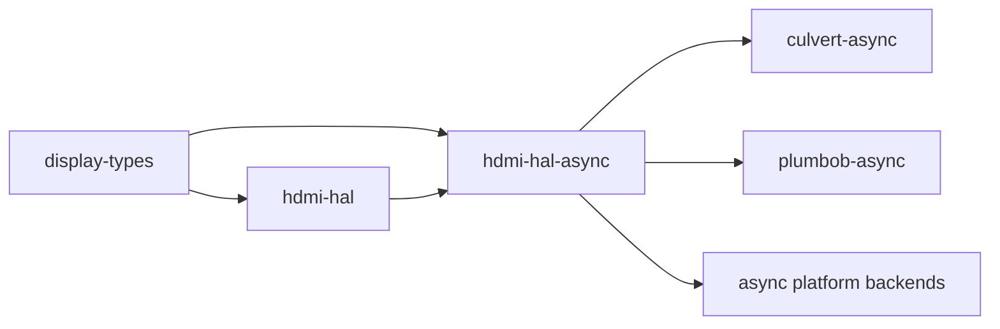

# hdmi-hal-async

[](https://github.com/DracoWhitefire/hdmi-hal-async/actions/workflows/ci.yml)
[](https://crates.io/crates/hdmi-hal-async)
[](https://docs.rs/hdmi-hal-async)
[](LICENSE)
[](https://blog.rust-lang.org/2025/02/20/Rust-1.85.0.html)
[](https://slsa.dev)
[](#verifying-releases)

> **Part of [Ashlar](https://ashlar-display.org)** — a display connection stack in Rust,
> HDMI 2.1 first: from EDID parsing through mode negotiation to FRL link training.
>
> [display-types](https://github.com/DracoWhitefire/display-types) ·
> [piaf](https://github.com/DracoWhitefire/piaf) ·
> [concordance](https://github.com/DracoWhitefire/concordance) ·
> [cartouche](https://github.com/DracoWhitefire/cartouche) ·
> [culvert](https://github.com/DracoWhitefire/culvert) ·
> [plumbob](https://github.com/DracoWhitefire/plumbob) ·
> [hdmi-hal](https://github.com/DracoWhitefire/hdmi-hal) ·
> **hdmi-hal-async** ·
> [hdmi-hal-i2c-dev](https://github.com/DracoWhitefire/hdmi-hal-i2c-dev)

Async hardware abstraction traits for the HDMI stack.

`hdmi-hal-async` is the async companion to [`hdmi-hal`](https://crates.io/crates/hdmi-hal),
following the same split as `embedded-hal` / `embedded-hal-async`. It mirrors each trait
in `hdmi-hal` with `async fn` methods and otherwise identical signatures — `ScdcTransport`
for raw SCDC register access and `HdmiPhy` for transmitter PHY control. Data types such as
`EqParams` are defined in `hdmi-hal` and re-exported here rather than duplicated.

Sync consumers continue to use `hdmi-hal` directly. Async platform backends (Embassy
drivers, async kernel drivers) implement the traits here. The two crates impose no
executor dependency on each other or their consumers.

## Usage

```sh
cargo add hdmi-hal-async
```

Implement a trait against your async hardware backend:

```rust
use hdmi_hal_async::scdc::ScdcTransport;

struct MyAsyncI2cBackend { /* ... */ }

impl ScdcTransport for MyAsyncI2cBackend {
    type Error = MyError;

    async fn read(&self, reg: u8) -> Result<u8, MyError> { /* ... */ }
    async fn write(&mut self, reg: u8, value: u8) -> Result<(), MyError> { /* ... */ }

    // One DDC transaction for the whole buffer (a length limit, if any, of at least
    // 16 bytes). A backend that cannot burst-read
    // implements this with `hdmi_hal_async::scdc::read_block_bytewise(self, reg, buf).await`
    // and says so: its reads are then one register at a time.
    async fn read_block(&self, reg: u8, buf: &mut [u8]) -> Result<(), MyError> { /* ... */ }
}
```

A future may be dropped before it completes (a timeout, a `select!`); the trait
documentation says what a transport promises then. To stop early, check the deadline
before each call rather than dropping a call in flight.

Accept a trait bound in consumer code:

```rust
use hdmi_hal_async::scdc::ScdcTransport;

async fn configure_frl<T: ScdcTransport>(transport: &mut T) -> Result<(), T::Error> {
    transport.write(0x31, 0x01).await?; // initiate FRL
    Ok(())
}
```

### Multi-threaded executors

The plain traits promise nothing about their futures, so code generic over them cannot
spawn on a multi-threaded executor. For that, each trait has a `Send` twin,
`phy::SendHdmiPhy` and `scdc::SendScdcTransport`: the same methods, returning futures
that are `Send`, with errors that are `Send`. A transport twin is also `Sync`, because
`read` takes `&self`.

```rust
use hdmi_hal_async::scdc::SendScdcTransport;

impl SendScdcTransport for MyThreadSafeBackend {
    type Error = MyError;

    async fn read(&self, reg: u8) -> Result<u8, MyError> { /* ... */ }
    async fn write(&mut self, reg: u8, value: u8) -> Result<(), MyError> { /* ... */ }
    async fn read_block(&self, reg: u8, buf: &mut [u8]) -> Result<(), MyError> { /* ... */ }
}

fn spawn_frl_start<T: SendScdcTransport + 'static>(mut transport: T) {
    tokio::spawn(async move { transport.write(0x31, 0x01).await });
}
```

A twin implementation is also an implementation of the plain trait, so it works with
code written against either. Import the trait your code is bounded by: with both in
scope, method calls on a twin implementation are ambiguous. Bound generic code by the twin
alone, as above: adding `+ ScdcTransport` or `+ HdmiPhy`, which the twins imply anyway,
makes the compiler use that bound instead of the blanket implementation, and the futures
are no longer known to be `Send`.

## Stack position

`hdmi-hal-async` mirrors `hdmi-hal`'s position in the stack, serving async platform
backends and async protocol logic. It depends on `hdmi-hal` for shared data types.



## Out of scope

- **Protocol logic** — typed SCDC register wrappers and async link training belong in
  the crates that consume `ScdcTransport`.
- **Implementations** — async platform backends live in the crates that use these traits.
- **Sync/async adapters** — wrappers that bridge sync implementations to async trait
  bounds belong in a compatibility shim crate, not here.
- **Executor dependency** — the traits impose no constraint on which async runtime is used.

## Documentation

- [`doc/architecture.md`](doc/architecture.md) — trait surfaces, design principles, and async/sync split
- [`doc/roadmap.md`](doc/roadmap.md) — planned features and future work

## Verifying releases

Releases are built on GitHub Actions and attested with
[SLSA Build Level 2](https://slsa.dev) provenance (from 0.2.0). To verify a release
`.crate` against its signed provenance, install the
[GitHub CLI](https://cli.github.com/) and run:

```sh
gh attestation verify hdmi-hal-async-X.Y.Z.crate --repo DracoWhitefire/hdmi-hal-async
```

The attested `.crate` is attached to each
[GitHub release](https://github.com/DracoWhitefire/hdmi-hal-async/releases).

Releases from 0.2.0 are uploaded through crates.io
[trusted publishing](https://rust-lang.github.io/rfcs/3691-trusted-publishing-cratesio.html): the publish
workflow obtains a short-lived token via OpenID Connect instead of using a stored
API token. crates.io can also reject uploads made with an API token for this crate;
the badge above shows whether that setting is on. Each version's publishing details,
including the workflow run and commit, are available from the crates.io API:

```sh
curl -A "your-tool (contact)" https://crates.io/api/v1/crates/hdmi-hal-async/X.Y.Z
# see .version.trustpub_data
```

0.0.1 (by hand) and 0.1.0 (from CI) were uploaded with an API token; they carry no
provenance and have no GitHub release.

## License

Licensed under the [Mozilla Public License 2.0](LICENSE).
